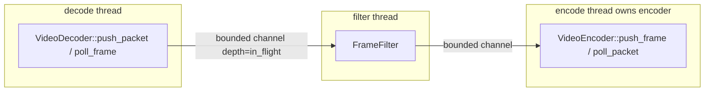

# ADR-0007: In-flight depth knob and decode→filter→encode pipelining

- **Status**: Accepted (encoder knob) · Proposed (decoder knob, facade pipeline helper)
- **Date**: 2026-11-17
- **Deciders**: @dev-nyxie (+ agent)
- **Crate**: `mediaway-encoder` (design also covers `mediaway-decoder` and the `mediaway` facade)

## Context

Throughput on hardware codecs depends on keeping more than one frame in flight: while frame N
is encoded, frame N+1 can be uploaded/filtered and frame N−1's packet read back. Several
backends have a native depth control; Mediaway exposed none. The workspace async rule
([ADR-0007 workspace](../../../docs/adr/0007-async-and-streaming.md)) keeps sans-io cores
sync/poll and puts concurrency in facades/adapters behind optional features.

Per-backend reality (checked in source, 2026-11-17):

| Backend | Native depth control | Today |
|---------|---------------------|-------|
| VideoToolbox encode | `kVTCompressionPropertyKey_MaxFrameDelayCount` | **wired** to `in_flight` |
| oneVPL `QuickSync` | `mfxVideoParam::AsyncDepth` | **wired** (session still syncs per frame) |
| WMF async MFT (DX11 Zero-Copy) | none portable — MFT emits `METransformNeedInput` itself | ignored |
| WMF sync MFT (CPU upload) | none | ignored |
| VA-API encode | surface pool sized by GOP/DPB math; `vaSyncSurface` per `push_frame` | ignored |
| Vulkan / D3D12 video encode | per-frame fence wait inside `push_frame` | ignored |
| AMF / NVENC / `MediaCodec` / `WebCodecs` | have queues; not wired yet | ignored |
| Decoders (all) | VA-API pools are reference-math sized; VT/WMF have no depth property | no knob added |

## Decision

> Add `VideoEncoderConfig::in_flight: Option<NonZeroU32>` (`None` = backend default, zero
> behavior change). Wire it only where a real native control exists. Do **not** add a decoder
> knob or a threaded facade pipeline helper yet.

- `in_flight` is a request; unlisted backends ignore it (documented on the field).
- **No decoder field:** no decoder backend has a native depth control that this field would
  drive. A field every backend ignores would be a dishonest knob (ADR-0006 workspace).
- **No threaded pipeline helper in the facade (yet):** platform sessions are frequently
  `!Send` (`Rc<Display>` in VA-API, COM apartment rules in WMF, `Rc` in Vulkan), so a helper
  that moves decoder/encoder onto worker threads cannot be generic over them without forcing
  `Send` bounds or per-backend thread affinity. Overlap is instead obtained by:
  1. backend-internal depth (`in_flight`), and
  2. GPU-side ordering instead of CPU stalls (`mediaway` ADR wgpu/0006), and
  3. callers driving `push_frame`/`poll_packet` non-greedily (push N before polling).

### Future pipeline helper sketch (when Send-able sessions exist)

Bounded `std::sync::mpsc::sync_channel(in_flight)` per stage, optional feature, sessions
constructed **on** their owning thread (avoids `Send` on the session itself).

## Alternatives Considered

| Alternative | Why not |
|-------------|---------|
| Map `in_flight` onto VA-API surface count | Extra surfaces do not pipeline a backend that syncs every frame; misleading. |
| `async` facade over every backend | Requires a runtime or `Send` sessions; violates workspace ADR-0007 defaults. |
| Decoder `in_flight` now | No backend would honor it. |

## Consequences

### Positive

- Real throughput knob on macOS/iOS and `QuickSync`; explicit table of what is ignored.

### Negative / Trade-offs

- Breaking for struct-literal construction of `VideoEncoderConfig` (pre-1.0; constructors
  unaffected).
- **Not hardware-verified:** VideoToolbox path compile-checked for `aarch64-apple-darwin`
  only; `QuickSync` compiled on Linux only.

## References

- `src/video.rs` (`VideoEncoderConfig::in_flight`)
- `mediaway` [ADR wgpu/0006](../../mediaway/adr/wgpu/0006-copy-frame-cross-api-fence.md)
- `docs/spec/async-and-streaming.md`, `docs/spec/caveats-and-clarity.md`
