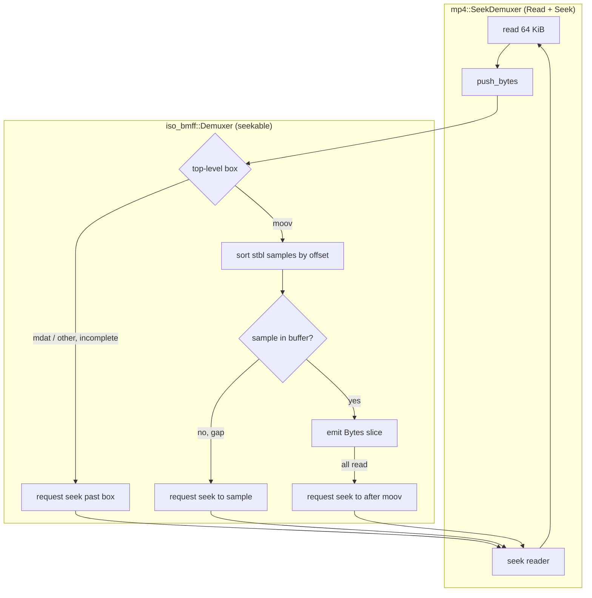

# MP4 demux: zero-copy payloads, seekable mode, faststart

`iso-bmff` ADR-0010 / ADR-0011 · `crates/iso-bmff/src/demux/mod.rs`,
`crates/iso-bmff/src/isobmff/faststart.rs`, `crates/mediaway-container/src/mp4_io.rs`.

- **Zero-copy payloads:** the demuxer's input is a `BytesMut`; a complete top-level box is split
  off (`split_to` + `freeze`) and samples are `Bytes` slices of it. No `drain` compaction.
  Only protected samples (CENC with a key) are copied, to decrypt in place.
- **`to_avcc_bytes` / `to_hvcc_bytes`:** take `Bytes`; an already length-prefixed payload returns
  the same buffer. The muxer uses them. `to_avcc(&[u8])` still copies on pass-through.
- **Push mode** (`Demuxer::new`): unchanged semantics; moov-at-end retains every `mdat`.
- **Seekable mode** (`Demuxer::new_seekable`): after each `push_bytes`, `poll_seek()`; `Some(off)`
  means "push from `off` next" — bytes pushed before taking it are dropped.
- **Faststart:** `isobmff::plan_faststart` / `relocate_moov` (sans-io), `isobmff::faststart`
  (whole buffer), `mediaway_container::mp4::faststart(Read+Seek, Write)` (streams `mdat`).
  `stco` widens to `co64` past 4 GiB. `saio`/`iloc` offsets are NOT rewritten.

- Seekable mode emits unfragmented samples in **file order** (tracks interleaved).
- Tests: `crates/iso-bmff/tests/moov_at_end.rs`, `crates/mediaway-container/src/mp4_io_tests.rs`
  (generated fixtures: `write_ftyp` + `mdat` + `write_indexed_moov`).
