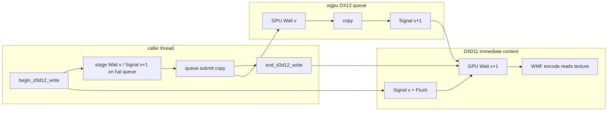

# Sync, in-flight depth, readback copy counts

Learned 2026-11-17. **None of this was hardware-run** — compile/clippy only (see per-item).

## wgpu → WMF: `WgpuDx12Bridge::copy_frame` GPU fence

`mediaway` ADR [wgpu/0006](../../../../crates/mediaway/adr/wgpu/0006-copy-frame-cross-api-fence.md).
`D3d12SharedEncodeBridge` opens one `D3D12_FENCE_FLAG_SHARED` fence on D3D12 and on the native
D3D11 device (`ID3D11Device5::OpenSharedFence`), best-effort. `wgpu-hal` 30 DX12 `Queue` has
`add_wait_fence`/`add_signal_fence` (staged on the **next** `submit`). Fallback without fence:
old `poll(Wait)` CPU stall. Assumes WMF MFT reads via the device immediate context (unverified).

One fence, monotonically increasing values, both directions (covers the write-after-read
hazard on the single-buffered destination). `handle()` and the decode bridge still stall.
Compiled: `cargo clippy --target x86_64-pc-windows-msvc` (lib only).

## `VideoEncoderConfig::in_flight`

`mediaway-encoder` [ADR-0007](../../../../crates/mediaway-encoder/adr/0007-in-flight-depth-and-pipelining.md).
`Option<NonZeroU32>`, `None` = backend default. Wired: VideoToolbox
`MaxFrameDelayCount` (checked `aarch64-apple-darwin`), oneVPL `AsyncDepth`. Ignored elsewhere:
VA-API/Vulkan sync per `push_frame`, WMF async MFT depth comes from `METransformNeedInput`.
No decoder knob (nothing would honor it). No threaded facade pipeline: sessions are often
`!Send` (`Rc<Display>`, COM, `Rc`) — design sketched in the ADR.

## Readback copy counts

- WebCodecs decode luma readback (`decoder/src/web/wasm.rs`): `copyTo` into a JS buffer, then
  per-row `subarray().copy_to()` straight into the final `Vec` — the old whole-buffer
  `to_vec()` temporary is gone. A wasm-memory `&mut [u8]` `copyTo` target is unsafe across the
  promise await, so one JS-heap hop remains.
- Vulkan decode: GPU-resident output already exists — `VideoOutputPreference::ZeroCopyGpu`
  (the **default**) returns `GpuBufferHandle::Vulkan { image, memory = layer+1 }`
  (`vulkan/zero_copy.rs`); `cpu_readback.rs` runs only for explicit `CpuFramesOk`.
